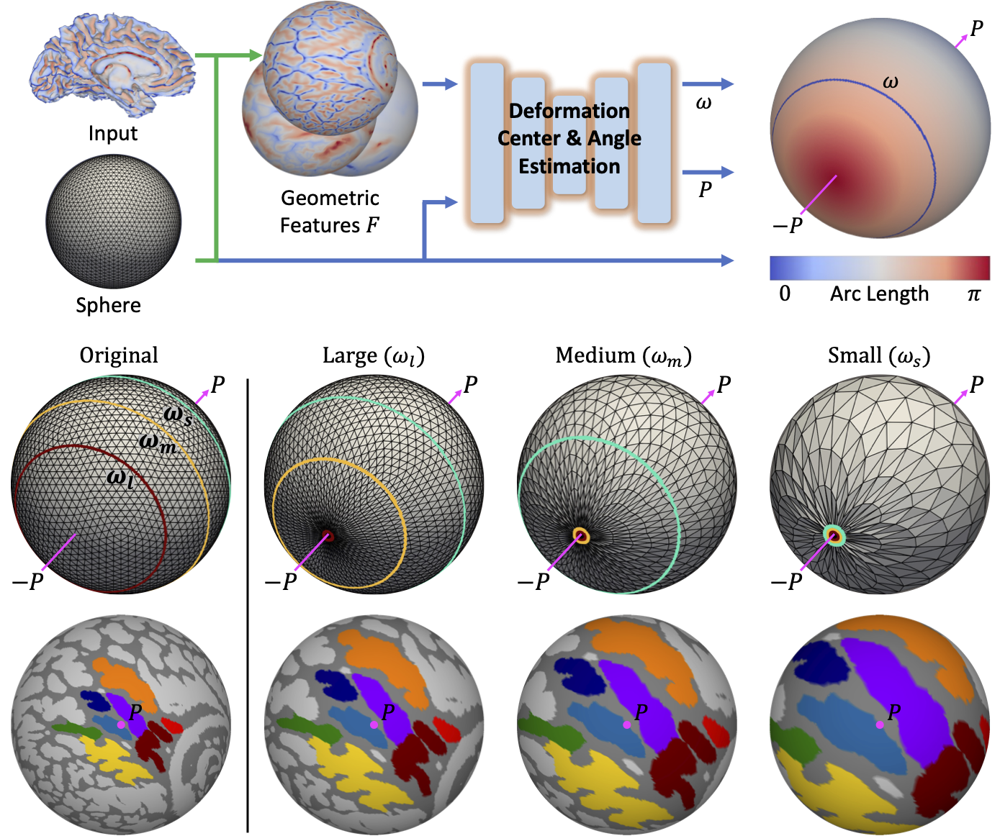
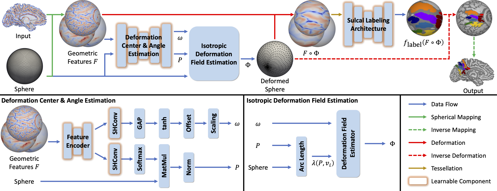

# LDSPHARM-Net: Isotropic spherical region enlargement and background contraction for sulcal labeling

[](https://github.com/Shape-Lab/SPHARM-DNNs-dev/blob/release/LICENSE)
[](https://pytorch.org)
[](https://www.python.org)
[](https://gcc.gnu.org)
[](https://gcc.gnu.org)
[](https://developer.nvidia.com/cuda-toolkit)


**Journal Paper**: Elsevier Medical Image Analysis (Jan 2027)

$\rightarrow$ [Isotropic spherical region enlargement and background contraction for sulcal labeling](https://doi.org/10.1016/j.media.2026.104303)

**Conference Paper**: IEEE 22nd International Symposium on Biomedical Imaging (Apr 2025)

$\rightarrow$ [Extensive Spherical Region Enlargement With Isotropic Deformation for Sulcal Labeling](https://doi.org/10.1109/ISBI60581.2025.10981062)


## Abstract


> The cortical sulci of the posterior medial cortex play a crucial role in cognitive and behavioral functions. However, automatic labeling of these sulci is challenging due to severe class imbalance (i.e., only a small portion of the cortex is labeled) and high neuroanatomical variability. To tackle these challenges, we propose an effective spherical deformation-based sulcal labeling method that automatically enlarges the sulcal regions of interest (ROIs) while contracting unlabeled regions. This allows the proposed method to capture detailed sulcal patterns more effectively and suppress confounding analogous patterns. Specifically, we introduce a generic expansion function with a generalized condition for homeomorphic isotropic deformation. Based on this, we propose a parameterizable exponential expansion design which provides flexibility to fully accommodate non-uniform spatial densities of sulcal ROIs. We also propose an end-to-end $SO(3)$-equivariant model to enhance its expressive power while improving generalization capability under data scarcity. Furthermore, we offer an explicit regularization on the extent of deformation to provide the stable enlargement of ROIs while preventing the unintended contraction. In the experiments, we show that the proposed method outperforms baseline methods on both adult and pediatric cohorts, particularly in small and variable ROIs. The most notable improvement of 11.16\% in Dice score was observed in the smallest sulcus, which is hominoid-specific and implicated in cognition and different neurodevelopmental and clinical disorders. Strong negative correlations between performance gains and ROI size confirm its suitability for labeling small sulci.

## Methods


> A schematic overview of the proposed method. The geometric features $F$ are mapped onto the unit sphere, where the learnable deformation center $P$ and angle $\omega$ are estimated, leading to the estimation of the isotropic deformation field $\phi$. The estimated $\phi$ is applied to the geometric features $F$ and the deformed features $F \circ \phi$ serve as input to the sulcal labeling architecture $f_{\text{label}}$. The inverse of the deformation field $\phi^{-1}$ recovers the original morphology of the labeled output, then recovered labels are mapped back to the original cortical surface. Notably, the Deformation Center & Angle Estimation module and the sulcal labeling architecture ($f_{\text{label}}$) are designed to be $SO(3)$-equivariant, ensuring this property for the entire pipeline.


## Getting Started

Clone the following repositories:
```bash
git clone https://github.com/Shape-Lab/SPHARM-Net.git
git clone https://github.com/Shape-Lab/LDSPHARM-Net.git
```

Create environment and install the requirements under `conda`:
```bash
conda create -n ldspharm-net python=3.10
conda activate ldspharm-net
```

Configure the environment with specific compiler and toolchain versions (gcc=12.4.0, g++=12.4.0, and NVCC=13.1):
```bash
conda install -c conda-forge gcc_linux-64==12.4.0 gxx_linux-64==12.4.0
conda install -c nvidia cuda-toolkit==13.1

conda env config vars set \
  CUDA_HOME="$CONDA_PREFIX" \
  CUDAHOSTCXX="$CONDA_PREFIX/bin/x86_64-conda-linux-gnu-g++" \
  CC="$CONDA_PREFIX/bin/x86_64-conda-linux-gnu-gcc" \
  CXX="$CONDA_PREFIX/bin/x86_64-conda-linux-gnu-g++"

conda activate ldspharm-net
```

Install PyTorch and dependencies:
```bash
pip install torch==2.10.0+cu130 --extra-index-url https://download.pytorch.org/whl/cu130

cd SPHARM-Net && pip install .
cd ../LDSPHARM-Net && pip install --no-build-isolation .
```

## Dataset
This project utilizes publicly available neuroimaging datasets and expert manual annotations:
- [**HCP (Human Connectome Project)**](https://www.humanconnectome.org/)
- [**NORA (Neurodevelopment of Reasoning Ability)**](https://bungelab.berkeley.edu/nora-the-brain-explorer/)
- [**PMC (Posterior Medial Cortex) Manual Annotation**](https://github.com/cnl-berkeley/stable_projects/tree/main/TripartiteLandmark_PosteriorCingulate)


## Data Preparation
| Variable | Description |
| :--- | :--- |
| `${subj_dir}` | Path to the FreeSurfer reconstruction output directory containing native surface geometries (e.g., `surf/?h.sphere`, `surf/?h.curv`) |
| `${data_dir}` | Path to the directory storing re-tessellated spherical mesh data encoded in binary format (e.g., `features/100206.?h.aug0.curv.dat`) |
| `${fold}` | Fold index for cross-validation which specifies the partition of data split (e.g., `1`) |

### 1. FreeSurfer Pipeline
Cortical surfaces (`?h.white`) along with their spherical parameterizations (`?h.sphere`) and geometric features (`?h.curv`) are extracted from structural T1 MRI scans using the standard FreeSurfer `recon-all` command:

```bash
recon-all -subject <SUBJECT> -sd ${subj_dir} -i ./T1.nii.gz -all -threads 1 
```

### 2. Spherical Re-tessellation
To establish a unified canonical spherical space across subjects and enable equivariant spherical processing, geometric features are re-tessellated onto a semi-regular icosahedral subdivision grid using the [SPHARM-Net](https://github.com/Shape-Lab/SPHARM-Net) pipeline. The resulting resampled geometric features are saved as binary-encoded data files (`.dat`) in `${data_dir}`.

### 3. Spherical Data Augmentation
To mitigate the data scarcity issue, we [augmented](https://github.com/ilwoolyu/SphericalRemesh) the input features by sampling intermediate deformations during [spherical registration](https://github.com/ilwoolyu/HSD) toward the target template (`$FREESURFER_HOME/average/?h.curvature.buckner40.filled.desikan_killiany.2010-03-25.gcs`).

### 4. Calculating Fréchet Mean
The deformation center $P$ can be optimally chosen as the spherical location which minimizes the arc lengths from $P$ to sulcal ROIs. Since sulcal labels are observable during training, the optimal center can be determined by solving the Fréchet mean. Following processes are implemented on assumption that `./frechet` is located in `${data_dir}`.
```bash
# CPU Version (Recommended)
python ./scripts/frechet.py \
  --data-dir ${data_dir} \
  --classes 0 1 2 3 4 5 6 7 8 \
  --epochs 200 \
  --out-dir ${data_dir}/frechet \
  --seed 0 \
  --no-cuda \
  --det

# GPU Version
python ./scripts/frechet.py \
  --data-dir ${data_dir} \
  --classes 0 1 2 3 4 5 6 7 8 \
  --epochs 200 \
  --out-dir ${data_dir}/frechet \
  --seed 0 \
  --gpu 0 \
  --det
```
## Train
```bash
python ./scripts/train.py \
--data-dir ${data_dir} \
--classes 0 1 2 3 4 5 6 7 8 \
--fold ${fold} \
--hemi lh \
--learning-rate 0.01 \
--method exp \
--k -0.5 \
--delta 0.30 \
--gamma 500 \
--loss dl \
--gpu 0 \
--aug 15 \
--epochs 20 \
--in-ch curv sulc iH \
--seed 0 \
--log-dir ./logs \
--ckpt-dir ./logs \
--det
```

## Inference
```bash
python ./scripts/inference.py \
--subj-dir ${subj_dir} \
--hemi lh \
--native-sphere sphere \
--ckpt ./logs/best_model_fold${fold}.pth \
--out-dir ./output \
--gpu 0 \
--no-cc \
--seed 0 \
--det
```

## Citation
We work hard to share our code for better reproducible research. Please cite the following paper if you use (part of) our code for your research, including data preparation, neural networks, inference, utilities, etc.:
```
@article{lee2027isotropic,
  title={Isotropic spherical region enlargement and background contraction for sulcal labeling},
  author={Lee, Seunghwan and Son, Jiwon and Lee, Seungeun and Willbrand, Ethan H and Parker, Benjamin J and Bunge, Silvia A and Weiner, Kevin S and Lyu, Ilwoo},
  journal={Medical Image Analysis},
  volume={115},
  pages={104303},
  year={2027},
  doi={10.1016/j.media.2026.104303},
}

@inproceedings{lee2025extensive,
  title={Extensive spherical region enlargement with isotropic deformation for sulcal labeling},
  author={Lee, Seunghwan and Son, Jiwon and Lee, Seungeun and Willbrand, Ethan H and Parker, Benjamin J and Weiner, Kevin S and Lyu, Ilwoo},
  booktitle={2025 IEEE 22nd International Symposium on Biomedical Imaging (ISBI)},
  pages={1--5},
  year={2025},
  doi={10.1109/ISBI60581.2025.10981062},
}
```
